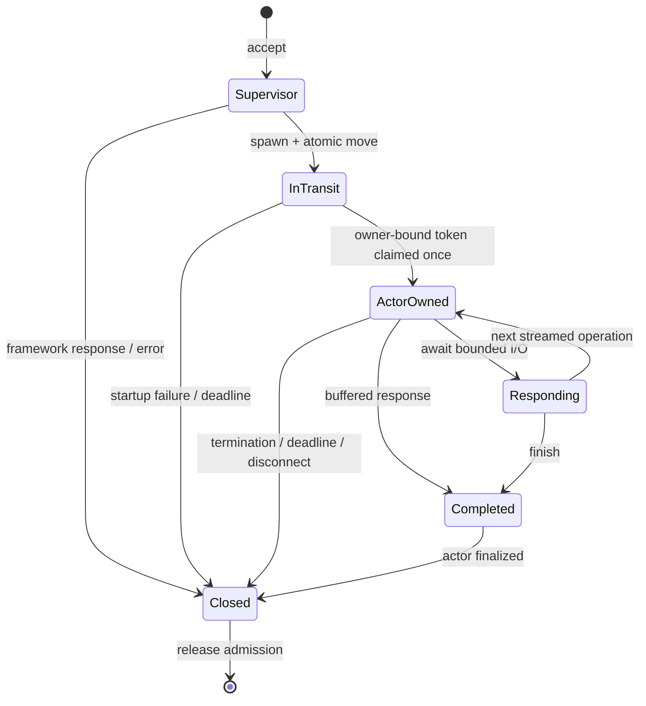

# Request ownership

## Actor-memory acceptance target

Every handler actor, shared or isolated, must have its own private allocation
arena and logical execution frames. Explicit shared application regions remain
separate and require checked ownership or reader/writer access. HTTP capability
transfer and mailbox delivery do not by themselves prove this storage boundary.
Tenant-VM work for untrusted actors comes after independent actor arenas and
frames are established; a tenant VM cannot substitute for that requirement.

The current Java Spin HTTP tests prove request capability behavior and executed
HTTP responses, not complete allocation/frame lowering or an independent GC heap
for every actor. LLVM Spin package execution remains unsupported at its pin.

An independently tested LLVM follow-up,
[PR #1649](https://github.com/ores-truffle-oreslang/oreslang-source.llvm/pull/1649),
commit `f4948859d5d455373275ef3a9018b8ebdaed5f59`, provides restricted **compiled
scalar actor** evidence: nonoverlapping 64-KiB frame regions, domain/turn denial,
actor-local 64-frame exhaustion, sibling progress, and fresh-incarnation
execution. O0/O2 run with a 512-KiB native stack; a separate ASan/UBSan build
instruments generated IR and runtime. Six focused local tests passed. This is a
separate compiler branch, not Spin's pinned LLVM or its HTTP server executing.

Remaining gates include all guest allocations (objects, strings, arrays and
closures), checked 32-bit arena references, concurrent-default actor invocations,
actor-owned call/operand/continuation frames through await and cancellation,
borrow/drop/unwind correctness, and physical resource retirement. Java and .NET
need their own equivalent compiler-backed evidence. No full actor-memory or
tenant-sandbox certification follows from the restricted LLVM result.

## Request capability lifecycle

The ownership generation changes at move, before token delivery. Every alias of
the original guest wrapper becomes stale (can_respond reports false; data/I/O
operations reject it). A failed delivery closes the request
and cancels the actor; it never leaves a live handle usable by two guest domains.
Claim checks both the runtime and the destination actor ID before consuming the
token. A wrong actor cannot steal or invalidate the rightful recipient's claim.
The transport supervisor retains cancellation/connection-lifecycle authority;
it does not retain guest access to the moved request body or response writer.

The native state contains synchronized framing and cancellation metadata. Guest
code only sees an opaque, domain-checked capability. Isolated actors do not get
Java references, raw FDs, parent closures, routing tables, or capture views.
Immutable scalar captures are attached before transfer. Actor-owned mutable
state is created by the actor runtime under that actor's execution domain.

A shared actor may use the language's permitted explicit shared-memory APIs for
application state. Its HTTP exchange still has one guest owner and one pending
I/O operation. This draft does not allow several actors to mutate an exchange
through a shared-memory cell. Shared mode selects the runtime actor policy; it
does not mean reusing one handler actor across requests.

This provides exclusive guest authority, not separate OS processes or a physical
socket relocation into an isolated heap. The native transport must still retain
connection and protocol state. That distinction preserves HTTP/1.1 keep-alive
and leaves a path to request-stream capabilities for a future HTTP/2 backend.

Actors call self.end after their final response/cleanup. A response that finishes
before actor termination retains its admission slot; the deadline remains active
until the actor exits. This bounds handlers that omit self.end. A disconnect is
detected on I/O failure, or by the deadline when no I/O is occurring. Failures
before headers produce an error response when possible; failures after headers
close the stream. The supervisor never retries a handler automatically.
