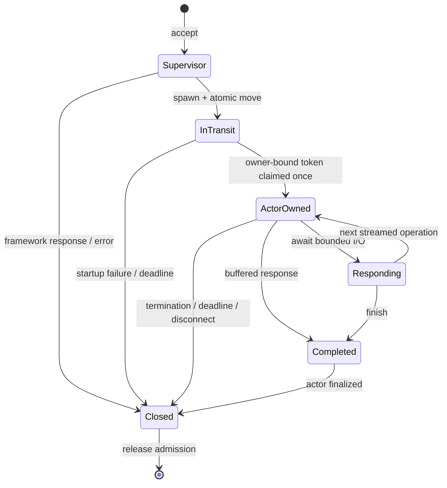

# Request ownership

## Actor-memory acceptance target

Every handler actor, shared or isolated, must have its own private allocation
arena and logical execution frames. Explicit shared application regions remain
separate and require checked ownership or reader/writer access. HTTP capability
transfer and mailbox delivery do not by themselves prove this storage boundary.
Tenant-VM work for untrusted actors comes after independent actor arenas and
frames are established; a tenant VM cannot substitute for that requirement.

The [shared-memory and mailbox contract](SHARED_MEMORY_AND_MAILBOXES.md)
separates guarded shared regions from actor-private storage and describes the
MessagePack data/capability boundary and remaining backend gates.
The [canonical checker checkpoint](BORROW_CHECKER_CHECKPOINT_20261110.md)
records merged Rust loop/projection analysis and exact-tree CI evidence, while
keeping independent compiler-adapter and runtime-isolation requirements open.

Each **execution context owns one logical stack**, including its nested call
frames. A receive is one entry point that can create an execution context;
stack ownership is not tied to the receive method. Synchronous calls use their
caller's stack, while independently scheduled work needs its own context/stack.
Await/resume and carrier migration retain the original context and stack.
Overlapping contexts need disjoint live stack storage under the actor's aggregate
heap quota. Completed contexts may release scrubbed arena bytes for reuse. A
carrier's machine stack or thread-local identity cannot substitute for this
logical stack.

The three backend implementations currently have different executed scopes:

- [.NET #461](https://github.com/ores-truffle-oreslang/oreslang-source.net/pull/461)
  connects statically source-generated scalar actors to the actual mailbox,
  native arena and execution-stack path. Local macOS and exact-tree private
  Linux/Windows NativeAOT checks execute each probe three times, including
  checked overflow, peer survival and retirement. See the
  [.NET native checkpoint](NET_NATIVE_ACTOR_CHECKPOINT_20261110.md) for source
  hashes, stepful run evidence and remaining language/runtime gates. This does
  not establish .NET Spin support or concurrent-default guest RW admission.
- [LLVM #1654](https://github.com/ores-truffle-oreslang/oreslang-source.llvm/pull/1654),
  commit `66ff048d03b3175ca6027e42667e862b3d96d1cf`, reconciles bounded native
  sealed-state source lowering with the execution infrastructure. Independent
  C++ ownership/codegen revalidation rejects stale schema/mode/effect claims.
  Seventeen local CTests pass, including 96 O0/O2 and 12 ASan/UBSan compiled
  sealed-state executions with no-GC IR audit. The Rust harness replaces the
  inherited new Python driver; 23 fixtures use `.atto`. This still uses a
  synchronous i64 `on_message` profile, not Java's exact receive/mail syntax,
  concurrent guest RW admission or compiled logical-stack lowering. It does not
  change Spin's LLVM pin or unsupported capability gate.
- [Java #2796](https://github.com/ores-truffle-oreslang/oreslang-source.java/pull/2796)
  combines the frame integration below with sealed-state RW loans on current
  main. It passes 306 focused tests plus four admission tests, 31 low-stack
  source/frame tests and Spin's 110 HTTP checks. Critical scopes retain the
  caller's execution identity and private frame allocation domain. Guest source
  scheduling remains serial; host RW overlap does not prove concurrent-default
  guests or general shared application-region access.
- [Java #2781](https://github.com/ores-truffle-oreslang/oreslang-source.java/pull/2781)
  reconciles actor-owned scalar frames with current main. It passes 71 frame
  tests, 39 boundary tests, seven low-stack guest tests, and Spin's real routing,
  builder and 110 HTTP checks. General native guest allocation remains open.
- [LLVM #1649](https://github.com/ores-truffle-oreslang/oreslang-source.llvm/pull/1649)
  executes restricted source-compiled scalar actors with disjoint native frame
  arenas, actor-local quota failure, sibling/replacement survival and sanitizers.
- [.NET #459](https://github.com/ores-truffle-oreslang/oreslang-source.net/pull/459),
  commit `9c0b65eb2fbf2ded17aded8c1579b466617c32b0`, makes each execution
  context own one logical stack, uses actor-owned physical storage, scrubs on completion/failure, and
  rejects later-DATA frame reuse while retaining persistent heap data. Its full
  managed verification executable passes, and its macOS arm64 NativeAOT host
  probe passes three runs with four private heaps and native budget reclamation.
  General compiler-generated `.atto` actors, authenticated continuation resume,
  concurrently live invocation stacks, and Linux/Windows execution remain open.

These results do not establish complete actor-memory separation across all three
compilers. Spin's LLVM and .NET package capability gates remain unchanged.

The current Java Spin HTTP tests prove request capability behavior and executed
HTTP responses, not complete allocation/frame lowering or an independent GC heap
for every actor. LLVM Spin package execution remains unsupported at its pin.

An independently tested LLVM follow-up,
[PR #1649](https://github.com/ores-truffle-oreslang/oreslang-source.llvm/pull/1649),
commit `f4948859d5d455373275ef3a9018b8ebdaed5f59`, provides restricted **compiled
scalar actor** evidence: nonoverlapping 64-KiB frame regions, domain/turn denial,
actor-local 64-frame exhaustion, sibling progress, and fresh-incarnation
execution. O0/O2 run with a 512-KiB native stack; a separate ASan/UBSan build
instruments generated IR and runtime. Six focused local tests passed. This is a
separate compiler branch, not Spin's pinned LLVM or its HTTP server executing.

[LLVM #1653](https://github.com/ores-truffle-oreslang/oreslang-source.llvm/pull/1653)
adds a separate retained-execution/stack bridge integration with current main.
Fourteen native runtime tests pass normally and under ASan/UBSan. A Rust driver
executes source-compiled scalar segments through the actual retained scheduler
at O0/O2 and under sanitizers. This is host-owned continuation bridging, not
general compiled guest `await`, concurrent-default actors, or LLVM Spin support;
the two LLVM branches have not yet been unified with Spin's routing pin.

Remaining gates include all guest allocations (objects, strings, arrays and
closures), checked 32-bit arena references, concurrent-default actor invocations,
actor-owned call/operand/continuation frames through await and cancellation,
borrow/drop/unwind correctness, and physical resource retirement. Java and .NET
need their own equivalent compiler-backed evidence. No full actor-memory or
tenant-sandbox certification follows from the restricted LLVM result.

## Request capability lifecycle

The ownership generation changes at move, before token delivery. Every alias of
the original guest wrapper becomes stale (can_respond reports false; data/I/O
operations reject it). A failed delivery closes the request
and cancels the actor; it never leaves a live handle usable by two guest domains.
Claim checks both the runtime and the destination actor ID before consuming the
token. A wrong actor cannot steal or invalidate the rightful recipient's claim.
The transport supervisor retains cancellation/connection-lifecycle authority;
it does not retain guest access to the moved request body or response writer.

The native state contains synchronized framing and cancellation metadata. Guest
code only sees an opaque, domain-checked capability. Isolated actors do not get
Java references, raw FDs, parent closures, routing tables, or capture views.
Immutable scalar captures are attached before transfer. Actor-owned mutable
state is created by the actor runtime under that actor's execution domain.

A shared actor may use the language's permitted explicit shared-memory APIs for
application state. Its HTTP exchange still has one guest owner and one pending
I/O operation. This draft does not allow several actors to mutate an exchange
through a shared-memory cell. Shared mode selects the runtime actor policy; it
does not mean reusing one handler actor across requests.

This provides exclusive guest authority, not separate OS processes or a physical
socket relocation into an isolated heap. The native transport must still retain
connection and protocol state. That distinction preserves HTTP/1.1 keep-alive
and leaves a path to request-stream capabilities for a future HTTP/2 backend.

Actors call self.end after their final response/cleanup. A response that finishes
before actor termination retains its admission slot; the deadline remains active
until the actor exits. This bounds handlers that omit self.end. A disconnect is
detected on I/O failure, or by the deadline when no I/O is occurring. Failures
before headers produce an error response when possible; failures after headers
close the stream. The supervisor never retries a handler automatically.
